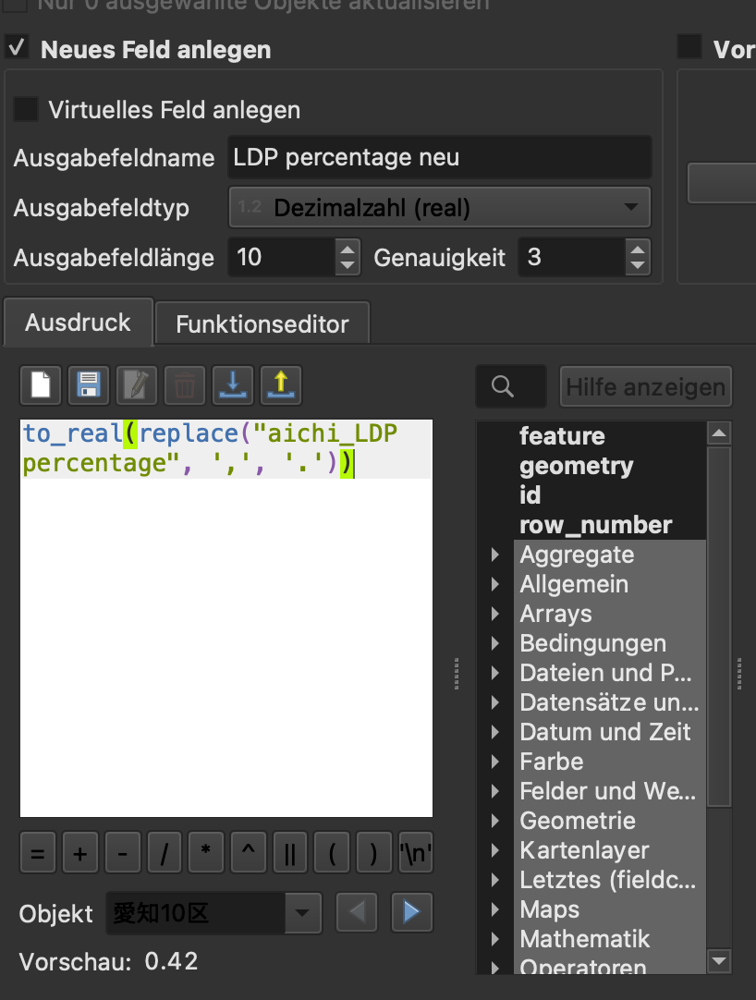
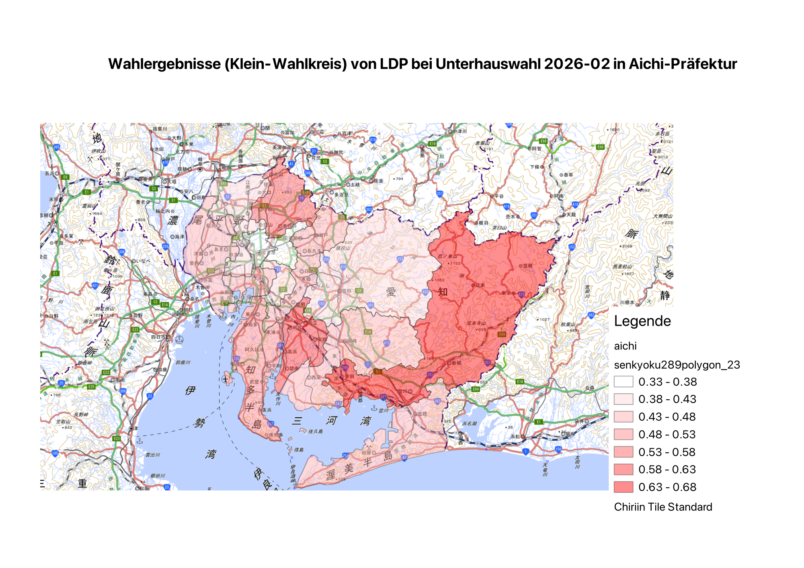

# QGIS for "Japanese Politics"

## Materials

### Base maps and map data
- [Geospatial Information Authority of Japan (GSI) tiles (国土地理院タイル)](https://maps.gsi.go.jp/development/ichiran.html)
- [OpenStreetMap raster tile providers](https://wiki.openstreetmap.org/wiki/Raster_tile_providers)
- [Statistical data and map data (polygons) for single-member districts of the House of Representatives (衆議院議員選挙の小選挙区の統計データ及び地図データ（ポリゴンデータ）の提供ページ)](https://gtfs-gis.jp/senkyoku/)
- [Municipality and electoral district topography data – sample viewer (市区町村・選挙区地形データ 表示サンプル Viewer)](https://smartnews-smri.github.io/japan-topography/viewer/)
- [Municipality and electoral district topography data – GitHub (市区町村・選挙区地形データ 表示サンプル GitHub)](https://github.com/smartnews-smri/japan-topography)

### Data (selection)

- [Japan – election statistics (日本-選挙に関する統計)](https://ndlsearch.ndl.go.jp/rnavi/politics/post_204111)
- [Results of the 51st House of Representatives general election and the Supreme Court judges' national review (preliminary) (第51回衆議院議員総選挙・最高裁判所裁判官国民審査結果調（速報）)](https://www.soumu.go.jp/main_content/001055230.pdf)

51st House of Representatives general election = lower house election of 2026-02-08

## Example walkthrough

### Adding a base map

1. Click QGIS > Layer > Add Layer > Add XYZ Layer => a pop-up window opens.
2. In the pop-up window "XYZ Connections", click "New" => a second pop-up window appears.
3. In the second pop-up window, enter the details for, e.g., the GSI standard tiles:

```
Name: any name you like
URL: https://cyberjapandata.gsi.go.jp/xyz/std/{z}/{x}/{y}.png (as given on the website)
Minimum zoom level: 5
```

4. Save with OK. You return to the first pop-up window.
5. Select the newly added tile connection from the drop-down menu and click "Add". The layer is added.

### Adding vector data
1. On the [sample viewer (市区町村・選挙区地形データ 表示サンプル)](https://smartnews-smri.github.io/japan-topography/viewer/), select "選挙区" (electoral districts) and "愛知県" (Aichi Prefecture).
2. Click "GeoJsonデータをダウンロード" (download GeoJSON data). The data is downloaded.
3. Drag and drop the GeoJSON file into QGIS to add it as a layer.

### Creating statistical data linked to map features
1. Create a table from the [results of the 51st House of Representatives general election and the Supreme Court judges' national review (preliminary) (第51回衆議院議員総選挙・最高裁判所裁判官国民審査結果調（速報）)](https://www.soumu.go.jp/main_content/001055230.pdf).
2. Load the table (CSV format, `./assets/aichi_votes_2026.csv`) into QGIS as a layer.
3. Right-click the vector layer > Properties > "Joins" > select the CSV layer to add the table's columns to the attribute table of the vector layer.
4. We want to visualize the values of "LDP percentage". However, the values in the table are stored as strings (they use a decimal comma), so the following conversion is necessary in QGIS: right-click the layer > "Open Attribute Table" > turn on "Toggle editing mode" (pencil icon) > "Open field calculator" > enter the settings as shown in the screenshot below and click "OK". Name the new field `LDP percentage neu` and set its type to "Decimal number (real)". This creates a new column containing numbers.
   This is the formula:

```
to_real(replace("aichi_LDP percentage", ',', '.'))
```



### Visualizing the statistics
1. Right-click the layer > Properties.
2. Symbology > select "Graduated" at the top.
3. Enter "LDP percentage neu" as the "Value". Adjust the interval size as needed, then click "Classify".

### Exporting the visualization for your own work
1. Select "New Print Layout".
2. Add the map, legend, labels, etc. to the canvas.
3. Export the result as an image.


