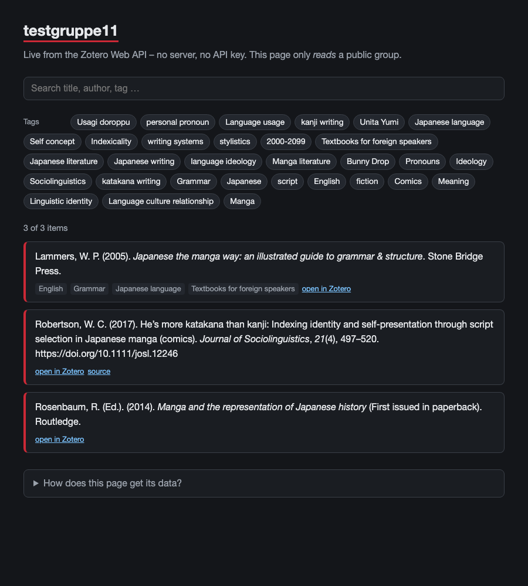

<!-- _class: lead -->
<!-- _paginate: false -->

# Using Zotero – Advanced
## Making the most of Group Libraries

60 min · hands-on · bring your own project or course

<!--
0–5 min. Welcome. Goal: everybody leaves with ONE concrete group setup they can create on Monday.
-->

---

## Today's goal

By the end of this session you will have

1. understood **what a group library is** (and is not)
2. seen **concrete usage examples** from research and teaching
3. **sketched – and created – a group** for your own project or course

> Basic Zotero is assumed: items, collections, tags, citing in Word/LibreOffice.

<!--
Quick show of hands / questions: who already uses a group? Who has tried and given up?
-->

---

## Schedule

| Min | Part |
|---|---|
| 0–5 | Intro and goal |
| 5–20 | Demo: groups, roles, permissions |
| 20–40 | Usage examples + the file-storage question |
| 40–55 | Hands-on: design and create your group |
| 55–60 | Wrap-up and open questions |

---

## Personal library vs. group library

<div class="cols">
<div>

**Personal library**
- yours alone
- your collections, your tags
- files: 300 MB free, or *WebDAV*
- you decide everything

</div>
<div>

**Group library**
- shared by several accounts
- one common set of items and collections
- files: only via *Zotero Storage*
- rules must be agreed on

</div>
</div>

> A group library is a **second library** that lives next to your own – items are copied in, not moved.

---

## Three group types

| Type | Who can see it | Who can join |
|---|---|---|
| **Private** | members and invitees only | by invitation |
| **Public, Closed** | everybody | by invitation or on request |
| **Public, Open** | everybody | anybody, instantly |

- Typical choice: **Private** for a project, **Public** for a reading list
- *Public, Open* groups **cannot share files** – metadata only
- The type can be changed later in the library settings

<!--
Demo: zotero.org → Groups → Create a New Group. Show the three options on screen.
-->

---

## Roles and permissions

- **Owner** – all admin rights, plus deleting the group or transferring ownership
- **Admin** – change group type, assign roles, adjust library settings
- **Member** – can do what the admins' settings allow

Settings to decide:

- *Library editing*: **any member** or **only admins** may add, edit and remove items
- *File editing*: **any member**, **only admins**, or **no file storage**

> Tip: use a dedicated *team account* as owner, so the group survives when a person leaves.

> Seminar reading list → members read-only. Research team → everybody edits.

---

## Demo: building a group (live)

1. Create the group (Private)
2. Invite a second account
3. Add a collection structure
4. Drag items in from the personal library
5. Add a **group note** with the tagging rules
6. Look at the library from the *other* account

<!--
Pre-lecture check: test group + second account must be ready. 5–20 min block.
Check how Japanese titles and authors display in the group library.
-->

---

## Shared collections that work

- Few top-level collections, named by **purpose** (not by person)
  `01 Sources` · `02 Secondary literature` · `03 Methods` · `99 To sort`
- One **inbox** collection: new items land there, someone sorts them weekly
- Items live in several collections – no copies needed
- Document the structure in a **pinned group note**

---

## Tag conventions

Agree on a tiny vocabulary *before* people start adding items.

- Status: `to-read` · `read` · `key`
- Type of source: `primary` · `secondary` · `method`
- Prefix rules for project tags: `proj:` · `theme:`
- Language: `lang:ja` · `lang:de` · `lang:en`

> Ten tags used consistently beat a hundred tags used randomly.

---

## Notes and duplicates

- **Child notes** on an item: summary in your own words, page references, questions
- **Standalone group notes**: rules, to-do lists, meeting minutes
- Several people add the same book → **Duplicate Items** → *Merge*
- Merging keeps all collections and tags of the duplicates

---

## Metadata first

> A group library is best at sharing **knowledge about sources**, not the sources themselves.

**Share**
- bibliographic data, DOIs, URLs
- tags, collections, notes in your own words

**Think twice before sharing**
- PDFs of paywalled articles and books
- scans of in-copyright material

<!--
Segue to the storage slide: that's both a copyright question and a quota question.
-->

---

## Usage examples (1/2)

**1. Research project – literature review**
Collections by theme · tags `to-read / read / key` · summary note per item

**2. Seminar – annotated bibliography**
Students add items and write a summary in *their own words*. No PDF attachments needed.

**3. Source criticism**
Group works on one corpus. Attach files **only** when open access or public domain.

---

## Usage examples (2/2)

**4. Public reading list**
*Public, Open* group. Handed from one cohort to the next; students only read.

**5. Department starter library**
Core reference works, standard editions, handbooks – maintained by one admin.

**6. Japanese Studies angle**
CJK titles and authors, readings in tags, consistent romanisation – and one agreed way to cite Japanese sources.

---

## Bonus: a public group on the web

<div class="cols">
<div>

A **public** group can be read by anyone – with the Zotero Web API. No account, no API key.

```
GET https://api.zotero.org/groups/<ID>/items
    ?format=json&include=bib&style=apa
```

- Returns ready-formatted citations
- Use it for a course website or a project page
- *Private* groups need an API key – keep it out of public pages

</div>
<div>



</div>
</div>

<!--
Just "this is possible" – 1 minute, no live coding. Demo page: zotero_group_demo.html (reads the test group live).
-->

---

## Files and storage: the facts

- Free: **300 MB** per account
- Files in a group library count against the **group owner's** storage – members need none
- **WebDAV does not work for group libraries**
  > "Group libraries cannot use WebDAV." – Zotero documentation, *Syncing*
- WebDAV is a workaround for *personal* libraries only

<span class="small">Sources: zotero.org/storage · zotero.org/support/sync · zotero.org/support/groups (checked 2026-10-14/15)</span>

---

## Paid storage plans

| Plan | Price (USD / year) |
|---|---|
| Free | 300 MB |
| 2 GB | 20 |
| 6 GB | 60 |
| Unlimited | 120 |

- One paying **owner** is enough for a whole group
- Group libraries draw from the owner's storage account

<span class="small">Source: zotero.org/storage (checked 2026-10-15) – re-check before you decide.</span>

---

## Working without storage

- **Link to files** instead of attaching: URL or DOI
- Library catalogue links (e.g. swisscovery)
- Open-access links (repository, publisher OA page)
- One paying owner for must-share, copyright-safe material
- Export annotations into **notes** – share your reading, not the PDF

> Everyone keeps the PDF in their *own* library – the group shares the record.

---

## Hands-on: sketch your group (5 min)

Fill in on paper or in a note:

1. **Purpose** – project, course, or reading list?
2. **Members** – who, and who is owner?
3. **Roles and type** – Private / Public? Who may edit?
4. **Collections** – 3 to 5 top-level names
5. **Tag rules** – status, type, language
6. **Files** – attach, link, or nothing?

---

## Hands-on: create it (10 min)

1. Create the group on zotero.org
2. Invite a neighbour (or a second account)
3. Create your collections
4. Add **3 items** from your personal library
5. Write the **tagging rules** as a group note
6. Check what your neighbour sees

> Stuck? Raise a hand – we look at it together.

---

## Wrap-up

- Group library = **shared metadata** and shared reading, not a file server
- Agree on **roles, collections, tags** first – technology second
- Files: link, don't attach – unless open access or one owner pays
- Start small: one group, one purpose

**Open questions?**

<span class="small">More material: https://nbtkmy.github.io/presentations/informationskompetenz/index.html</span>

---

<!-- _class: lead -->
<!-- _paginate: false -->

# Thank you

Nobutake Kamiya
